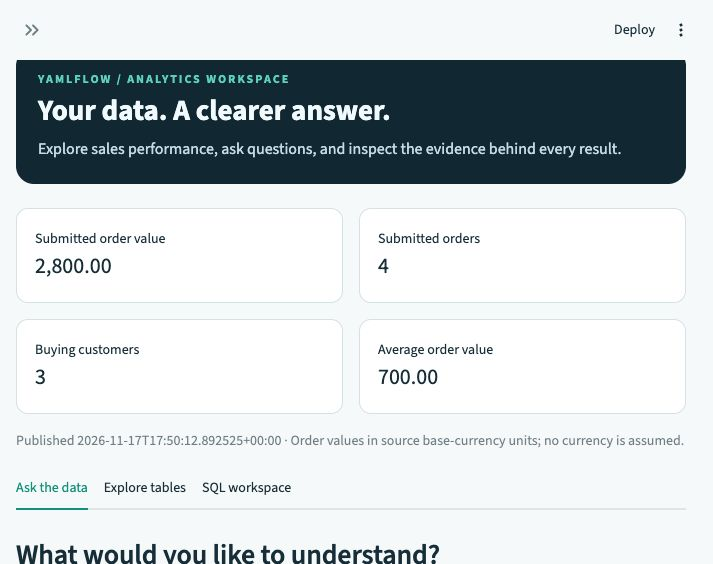
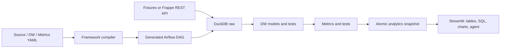

# YAMLFlow

**YAML-defined data pipelines, generated Airflow DAGs, DuckDB analytics, and a
Streamlit interface for exploring the results.**

This is a local Data Engineering proof of concept. Start with the bundled synthetic
sales data; no Salesforce account, ERPNext server, Docker, or API key is needed for
the basic demo. Docker is optional for Airflow. An OpenAI key/model is optional for
open-ended agent questions.

**[Start here: quickstart and playground exercises](docs/QUICKSTART.md)** ·
[Architecture](#how-it-fits-together) · [Recorded verification](VERIFICATION.md)



## Try the local demo

Prerequisites: Python 3.11 recommended, Git, and Make on macOS/Linux. On Windows,
use WSL2 for the current implementation, which uses Unix file locking.

```bash
git clone https://github.com/hmv3040/yamlflow-poc.git
cd yamlflow-poc
python3 -m venv .venv
source .venv/bin/activate
python -m pip install --upgrade pip
python -m pip install -e '.[analytics]' pytest
make demo
```

Open [the local analytics app](http://127.0.0.1:8501). Try a sample question, inspect
its SQL, explore the tables, or run your own SELECT. Press Ctrl+C to stop the app.
The first run downloads Python dependencies. The demo runs locally without a model
call; select AI agent and configure your own credentials for open-ended questions.

## How it fits together



The local CLI can execute the same pipeline without Airflow. YAML defines
configuration, dependencies, and metrics; transformations still use SQL inside
the DW YAML files. The generated DAG has **11 tasks** for the bundled project,
including quality gates and snapshot publication.

## What is implemented

- Typed YAML validation and dependency/cycle checks.
- Full-refresh ingestion from fixtures or a Frappe REST connector.
- DuckDB raw, DW, and analytics schemas, with transactional model replacement.
- Unique/non-null checks, rollback, and generated Airflow task dependencies.
- A Streamlit data explorer, read-only SQL workspace, charts, and CSV exports.
- An optional Responses API agent with schema/query tools and bounded SQL retries.

The default dataset is synthetic. Live ERPNext integration and live model calls
need user configuration and have not been verified against a real account. This is
a POC: incremental extraction, backfills, multiple users, and production deployment
are outside the current scope. No dbt dependency is used; the project explores a
declarative workflow inspired by tools such as dbt.

## Detailed setup

Define SaaS extraction, warehouse models, and business metrics in YAML. Compile the
project into an Airflow DAG with dependencies, retries, and quality gates.

**Stack:** Python · ERPNext/Frappe REST API · DuckDB · Apache Airflow · PostgreSQL
(Airflow metadata only). Fixture mode needs no ERPNext account or server.

The pipeline now includes a final analytics snapshot publishing task. See
[VERIFICATION.md](VERIFICATION.md) for recorded checks and remaining scope.
During verification, running this alongside another Airflow stack under Docker's
4 GB allocation caused timeouts. Run one stack at a time or provide more resources.

## Run locally

```bash
python3 -m venv .venv
source .venv/bin/activate
python -m pip install --upgrade pip
pip install -e '.[analytics]' pytest
export YAMLFLOW_DB="$PWD/data/analytics.duckdb"
yamlflow validate
yamlflow plan
yamlflow run
yamlflow test
yamlflow report
pytest -q
```

The fixtures contain 3 customers and 6 orders. Four orders are submitted; one is
draft and one cancelled. Expected submitted order value: **2,800**, with daily
values **2,000** and **800**. Values are synthetic, expressed in one base currency.
These are order metrics, not recognized revenue or cash receipts.

After installing dependencies, `make run`, `make report`, `make test`, and `make up`
are shortcuts that consistently use the shared `data/analytics.duckdb` path.

Without `YAMLFLOW_DB`, the local warehouse path is relative to the project folder.
The Docker configuration explicitly uses the repository's `data/analytics.duckdb`.

## Generate and run Airflow

```bash
source .venv/bin/activate
yamlflow compile
chmod g+w data
docker compose up -d --build
docker compose logs -f airflow
```

Open http://localhost:8081. The local SimpleAuthManager user is `admin`; find its
generated password in the Airflow startup logs. This is a local development setup.
You can also retrieve it with:

```bash
docker compose exec airflow cat /opt/airflow/simple_auth_manager_passwords.json.generated
```

The local supervisor starts only the API server, scheduler, and DAG processor.
No triggerer is needed for these Python tasks. Concurrency is limited to one task;
local API/parser timeouts allow for a resource-constrained Docker environment.
The Compose file uses shared development keys and binds the UI to loopback.

Once Airflow finishes initializing:

```bash
docker compose exec airflow airflow dags list-import-errors
docker compose exec airflow airflow dags unpause sales_analytics
docker compose exec airflow airflow dags trigger sales_analytics
```

Or run `make verify-airflow` to wait for readiness, check imports, unpause the DAG,
trigger a uniquely named run, and assert all eleven tasks succeed through the REST API.
The script is specifically for the bundled demo DAG and local SimpleAuthManager.

Startup creates the one-slot DuckDB pool automatically. The DAG starts paused
so you can inspect it before enabling its hourly schedule. It has
11 tasks: 2 raw loads, 2 DW builds, 2 metric builds, 4 quality gates, and a final
snapshot publisher for Streamlit. Builds
also validate inside their transaction before committing so bad results do not
replace the previous good table. The separate test tasks make quality gates visible.

Inspect the result in the container:

```bash
docker compose exec airflow yamlflow report --project /opt/airflow/dags/PROJECT_SNAPSHOT/project
```

Replace `PROJECT_SNAPSHOT` with the `_snapshot_sales_demo_...` directory produced
by compilation, or inspect the shared database locally with `yamlflow report` and
`YAMLFLOW_DB` set as above. Stop services with `docker compose down`; volumes remain.

## YAML layout

```text
examples/sales/
  project.yml                  # pipelines, schedules, retries, warehouse path
  sources/erpnext.yml           # API resources, columns, types, primary keys
  dw/*.yml                     # SQL, dependency references, quality checks
  metrics/*.yml                # dimensions, aggregation measures, quality checks
  fixtures/*.json              # reproducible source snapshots
```

Each business pipeline becomes one DAG; each resource/model becomes a task.
Dependencies refer to `source.<source>.<resource>`, `dw.<model>`, or
`metrics.<model>`. Every dependency must exist in the same pipeline. Cycles,
unknown fields, duplicate targets, and invalid identifiers fail validation.
SQL is trusted developer-authored project code; configuration is not a sandbox.

The compiler emits deterministic Python DAGs and content-addressed configuration
snapshots, including fixtures. Airflow parsing does not contact APIs or DuckDB.
After YAML edits, recompile; restart Airflow only if framework Python code changes
(rebuild its image). Old snapshots remain to support already-running tasks.

## Switch to a real ERPNext instance

1. Self-host ERPNext using its official Docker quickstart:
   https://github.com/frappe/erpnext#installation
   https://github.com/frappe/frappe_docker
2. Complete its setup wizard, create customers, items, and **submitted** sales
   orders. Use a single company/base currency for this POC.
3. Create an API user with read access to Customer and Sales Order. Generate its
   API key and secret. Only records visible to that user can be extracted.
4. Copy `.env.example` to `.env`, set `YAMLFLOW_SOURCE_MODE=erpnext`,
   `ERPNEXT_URL`, and `ERPNEXT_TOKEN=api_key:api_secret`. The URL must be reachable
   from the Airflow container; host port 8080 uses `host.docker.internal:8080`.
5. Recreate the Airflow service: `docker compose up -d --force-recreate airflow`.
   Trigger `sales_analytics`. The DW and metric YAML need no changes.

For a direct local run, export the same credentials with a host-reachable URL and
execute `yamlflow run --mode erpnext`.

The Frappe connector uses authenticated, paginated REST requests, explicit fields,
timeouts, and retries on rate limiting/transient server errors. It performs full
snapshot replacement, including removal of records no longer returned by the API.
Primary keys reject duplicates; failed loads roll back. HTTP extraction is finished
before a warehouse transaction begins. A changing API dataset is not a consistent
database snapshot, so avoid source writes during the small POC extraction.

## Streamlit analytics

```bash
source .venv/bin/activate
pip install -e '.[analytics]'
make publish
make analytics
```

Open http://127.0.0.1:8501. `make publish` exports the currently stored curated data;
run `make run` first if the warehouse has not been built. In Airflow, the final
`publish_analytics_snapshot` task automatically exports only after every build and
quality gate succeeds. Reload published data in the app after a new pipeline run.

The app provides submitted-order KPIs, table previews, a read-only SQL workspace,
CSV downloads, charts, and an analysis chat with visible SQL and tool steps.

**Local demo** executes four predefined questions without a model or network call.
It is explicitly a deterministic demo, not an LLM agent. For open-ended questions:

1. Select **AI agent** in the sidebar (expand the sidebar on narrow screens).
2. Enter your OpenAI API key and a tool-capable model ID available to your account,
   or configure `OPENAI_API_KEY` and `OPENAI_MODEL` in your ignored `.env` file.
3. Enable the checkbox allowing the question, schema, and query results to be sent
   to OpenAI. API calls are billed to your account. Browser-entered keys remain in
   the Streamlit session; the app does not write them to disk.
4. Ask a question. The agent can inspect schema, run bounded SQL, and repair errors.

The agent uses the Responses API with `get_schema` and `run_sql` function tools,
up to six model turns/eight tool calls, at most 100 returned rows per query, and
`store=False`. This flag does not promise zero provider retention; consult the
provider's account/data controls. The app does not invoke any external model in
local demo mode. Each chat question is analyzed independently, rather than using
previous chat messages as context. The latest twelve answers stay in session memory.

The app queries an isolated in-memory DuckDB database rebuilt from
`data/analytics_snapshot.json`. It never opens the live warehouse itself. Snapshot
publication is atomic; the last good file remains available if publication fails.
Snapshots include only DW/analytics schemas and reject tables exceeding 100,000
rows. They are intended for a small local POC, not large production datasets.

SQL is parsed and restricted to one SELECT over approved tables/CTEs and supported
analytical functions. External access is disabled; writes, catalog inspection,
file readers, unknown functions, recursive queries, and multiple statements are
rejected. Queries have a four-second execution timer and a 128 MB memory limit.
These are POC controls, not a multi-user security boundary. LLM interpretation can
still be wrong: the interface exposes query results, SQL, and snapshot timestamps
for inspection. Numeric answers are withheld if no successful SQL tool result exists.

Verification includes a mocked multi-turn agent repairing SQL and Streamlit's
AppTest. Live model calls require your API key and have not been verified without
one. Live ERPNext validation and incremental pipeline semantics remain separate
follow-up work.

## Scope and next steps

- Full refresh only; incremental cursors, source change capture, and backfills are
  future work. Catchup is deliberately disabled until interval semantics exist.
- Single-machine DuckDB with a one-slot Airflow pool and a local file lock.
  This is not a distributed worker/storage architecture.
- Model dependencies are explicit; SQL references are not automatically inferred.
- Aggregates support one input model, dimensions, and count/sum/avg/min/max.
- Quality tests support uniqueness and non-null checks. A required dimension
  join can drop orphan records; relationship checks should be added before using
  this with uncontrolled business data.
- `_yamlflow.runs` records warehouse task outcomes. API failures before warehouse
  access are recorded in Airflow task logs, not in this table.
- Streamlit reads an atomic curated snapshot, independently of warehouse writes.
- ERPNext is an external/self-hosted dependency; it is not bundled into our Airflow
  Compose file. Fixture mode is the default and must not be mistaken for live data.

## Design references

- Airflow configuration-driven DAG generation:
  https://airflow.apache.org/docs/apache-airflow/3.1.3/howto/dynamic-dag-generation.html
- Airflow local Docker development:
  https://airflow.apache.org/docs/apache-airflow/3.1.3/howto/docker-compose/index.html
- Frappe REST API: https://docs.frappe.io/framework/user/en/guides/integration/rest_api
- DuckDB concurrency: https://duckdb.org/docs/stable/connect/concurrency
- OpenAI function tools: https://developers.openai.com/api/docs/guides/function-calling
- Streamlit chat: https://docs.streamlit.io/develop/api-reference/chat/st.chat_input
